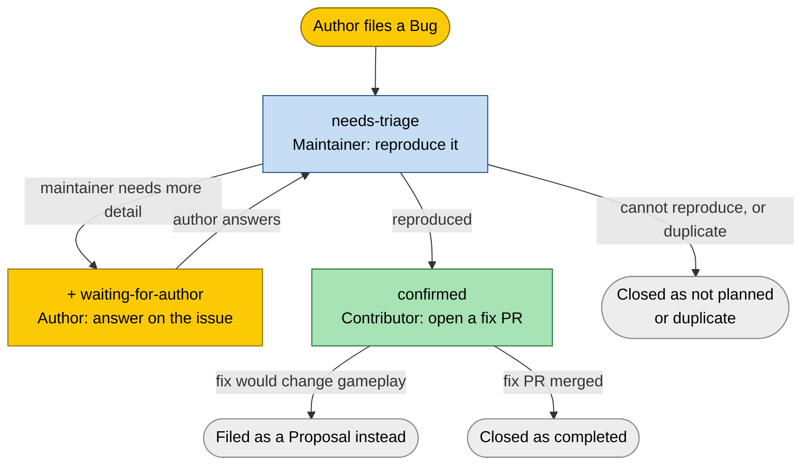
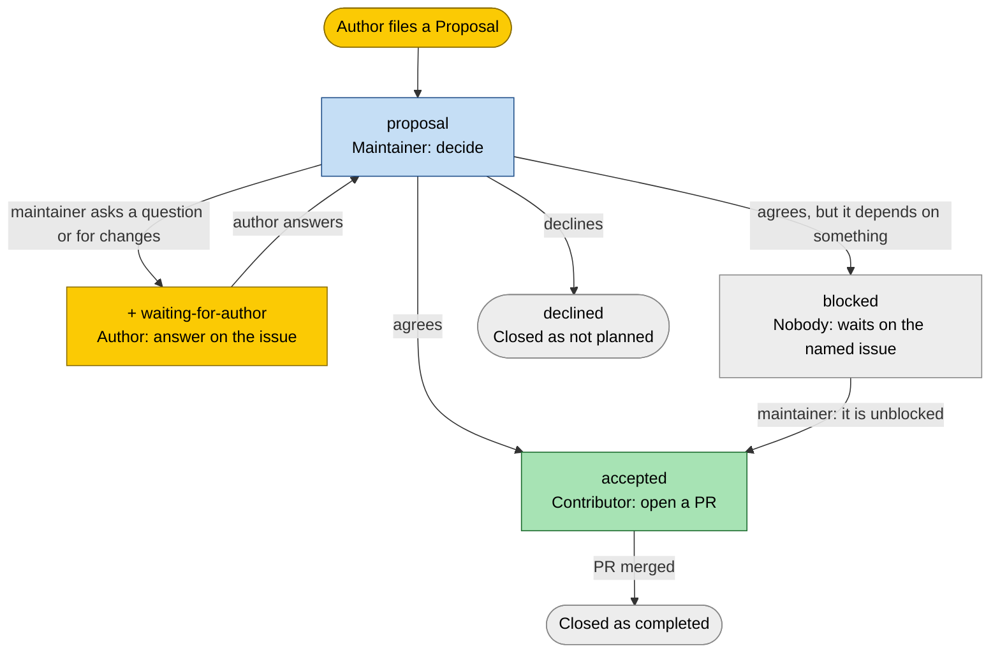
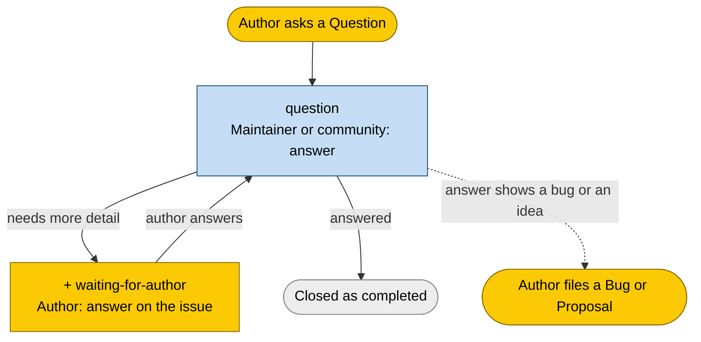

# Labels

Every issue has a label for its kind, and bugs and proposals also have one for where they stand. The issue forms add the first ones, and the maintainer changes them after that. When an issue moves on, the maintainer replaces its status label rather than adding a new one, for example `proposal` → `accepted` or `needs-triage` → `confirmed`. The labels are defined in [labels.yml](labels.yml) and applied to GitHub with `tools/sync-labels.sh`.

## What each label means

| Label | Kind | Meaning | Set by |
| --- | --- | --- | --- |
| `bug` | kind | Something does not work as it should | Bug form |
| `enhancement` | kind | A new feature or a change | Proposal form |
| `question` | kind | A question for the maintainer or the community | Question form |
| `needs-triage` | bug status | The maintainer has not reproduced the bug yet | Bug form |
| `confirmed` | bug status | The maintainer reproduced the bug; a fix PR can be opened | maintainer |
| `proposal` | proposal status | Waiting for the maintainer to decide | Proposal form |
| `accepted` | proposal status | Agreed; a PR can be opened | maintainer |
| `declined` | proposal status | The maintainer decided not to do this; the issue is closed | maintainer |
| `blocked` | proposal status | Agreed, but waiting on another issue or decision named on the issue | maintainer |
| `waiting-for-author` | any | The maintainer asked a question or for changes; it is the author's turn | maintainer |

Duplicates and invalid issues have no labels of their own. They are closed with GitHub's close reasons, such as "duplicate" or "not planned".

## Whose turn it is

Each chart below shows an issue's states as boxes. The colour of a box says who has to act next, and the arrows say what they do.

| Colour | Whose turn |
| --- | --- |
| Blue | The maintainer |
| Yellow | The author of the issue |
| Green | Any contributor, often the author |
| Grey | Nobody; the issue waits on something else, or it is closed |

`waiting-for-author` is added on top of the issue's status, so the issue keeps its place. When the author has answered, they say so on the issue and the maintainer removes the label. An issue with no reply for 30 days may be closed.

## How a bug moves

## How a proposal moves

## How a question moves

A question has no status label of its own.
